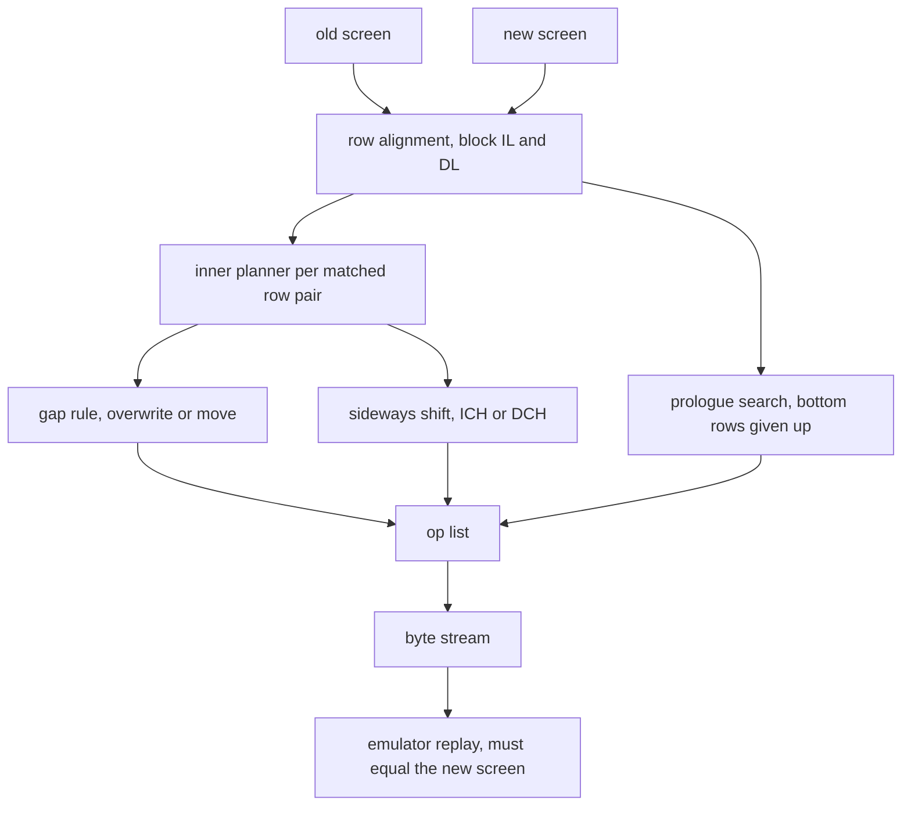
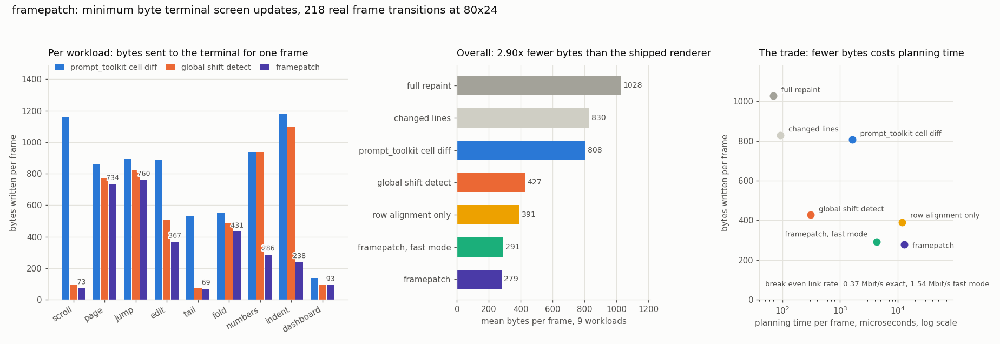

# framepatch

Minimum byte terminal screen updates, by aligning the old screen to the new one
instead of diffing it cell by cell.

## The problem

Every full screen terminal application holds two pictures: the screen the
terminal is currently showing and the screen it should be showing. Turning the
first into the second is the renderer's whole job, and the bytes it sends are
the cost of a frame.

Shipped renderers decide those bytes with a cell diff. prompt_toolkit, which is
the renderer behind IPython, ptpython and pgcli, walks every cell of the new
screen, compares it with the old one, and reaches each changed cell with a
cursor move. urwid and most hand written TUIs are coarser still and repaint a
whole row whenever anything in it changed.

A cell diff has one structural blind spot: it cannot see that the screen
moved. Scroll a pager by one line and every cell on the screen differs, so a
cell diff repaints all 24 rows, about 1.2 kB, to express something the terminal
can do itself in three bytes. The same blind spot applies sideways: switch line
numbers on and every character on every row has shifted right by five columns,
which a cell diff pays for in full.

That is invisible on a local terminal and expensive everywhere else: ssh over a
mobile or satellite link, a serial console on a switch or a BMC, tmux over a
WAN, a browser terminal streaming over a WebSocket. Terminals have had the
control functions to do this cheaply since the 1980s (insert line, delete line,
insert character, delete character) and renderers mostly do not use them,
because knowing which ones to send is a search problem nobody solves.

## What this does

framepatch takes two screens and produces the cheapest byte stream it can find
that turns one into the other, then proves the stream is right by replaying it
on a VT emulator and requiring the result to equal the target exactly.

It treats the update as an alignment at two levels.

Between rows, the old screen's rows are aligned against the new screen's rows.
An unmatched old row is deleted (DL), an unmatched new row is inserted (IL),
and a matched pair is repainted. Runs of deletions and insertions are charged
as one control function because DL and IL take a count, so a mid screen fold or
a page scroll costs a single sequence.

Within a row, the differing stretches must be written and the matching gaps
between them are a free choice: overwrite them at one byte per column, or jump
over them with a four to six byte cursor move. If the new row is the old row
shifted sideways, the terminal does the shift with ICH or DCH and only the
genuinely new characters are sent.

Every cost in the search is the length of a rendered sequence, never a model of
it, so the number the planner minimises is the number of bytes that go on the
wire.

## Why it is interesting

**The baseline is real, not a straw man.** The comparison runs
prompt_toolkit 3.0.52's own `_output_screen_diff` against the same frame pairs,
through its own Vt100 output object, and counts the bytes it emits. The
baseline number is what a widely deployed renderer actually sends, not a
reimplementation of what it might send.

**Inserting a line destroys information, and that is what makes the alignment
subtle.** IL pushes the bottom row off the screen, so content that left is not
available to match later. A planner that forgets this produces plans that are
cheaper on paper and wrong on a terminal. This was not a theoretical worry: the
first working version failed on 12 of 1308 streams for exactly that reason, and
the emulator caught every one. The fix is a prologue that deletes the bottom
rows outright before any insertion, which makes the model exact rather than
optimistic.

**The block transitions do not cost a quadratic dynamic program.** DL(n) and
IL(n) cost the same number of bytes for every n with the same number of digits,
so the candidate block sizes fall into three cost tiers, and running minima over
those tiers give the same answer in linear time.

**There is a measured optimality gap, and it is reported.** For screens small
enough to enumerate, Dijkstra over every reachable (screen, cursor) state gives
the genuinely cheapest stream any sequence of control functions could produce.
framepatch is never cheaper than that bound and is up to 8 bytes worse on a 3 by
2 screen. All of the gap is absolute cursor positioning, which the planner pays
once per touched row so that the cost of a row is independent of the rest of the
plan, which is what makes the alignment a dynamic program at all.

## Architecture

FigJam board: https://www.figma.com/board/xHB7c5MG2oopX08M6NyqGA

The diagram shows the path from a pair of screens to a verified byte stream:
the row alignment and the inner row planner feed one op list, the op list is
rendered to real bytes, and both framepatch and the third party baseline go
through the same emulator gate before any byte count is allowed into the table.



## Results



The metric is bytes written to the terminal for one frame, measured over 218
real frame transitions at 80 by 24 taken from nine workloads over real files in
the local Python standard library: scrolling, paging, jumping between search
matches, applying the real diff between a module and its unparsed form, tailing
a growing log, folding and unfolding definitions, switching line numbers on and
off, re-indenting a block, and refreshing a field dashboard the way `top` does.

The baseline is prompt_toolkit 3.0.52 driving its own renderer: **807.7 bytes
per frame**. framepatch sends **279.0 bytes per frame**, a factor of **2.90**,
or 60,819 bytes against 176,084 for the whole session.

| strategy | mean bytes per frame | planning time per frame |
|---|---|---|
| full repaint | 1027.8 | 0.07 ms |
| repaint changed rows | 830.1 | 0.09 ms |
| prompt_toolkit cell diff (baseline) | 807.7 | 1.61 ms |
| global shift detection | 427.3 | 0.31 ms |
| row alignment only, no ICH or DCH | 390.8 | 11.93 ms |
| framepatch, fast mode | 291.4 | 4.29 ms |
| framepatch | 279.0 | 12.96 ms |

Per workload, in bytes per frame:

| workload | full | changed rows | prompt_toolkit | global shift | framepatch |
|---|---|---|---|---|---|
| scroll | 1161 | 1161 | 1161 | 93 | 73 |
| page | 877 | 877 | 858 | 771 | 734 |
| jump | 901 | 901 | 895 | 821 | 760 |
| edit | 886 | 886 | 886 | 508 | 367 |
| tail | 719 | 504 | 529 | 74 | 69 |
| fold | 762 | 519 | 552 | 485 | 431 |
| numbers | 938 | 920 | 938 | 938 | 286 |
| indent | 1210 | 1170 | 1181 | 1098 | 238 |
| dashboard | 1752 | 411 | 138 | 93 | 93 |

Reading the numbers honestly:

**Most of the headline is available without this project.** Detecting one
global vertical shift, which pagers and scroll optimising renderers already do,
takes the baseline from 807.7 to 427.3 bytes per frame on its own. The part
that belongs to framepatch is 427.3 to 279.0, a factor of 1.53, and it comes
from two places the global rule cannot reach: structural changes that are not a
single shift (`edit` 508 to 367, `fold` 485 to 431, where a row is inserted or a
block disappears in the middle of the screen) and sideways shifts inside a row
(`numbers` 938 to 286, `indent` 1098 to 238, where IL and DL are useless and
only ICH and DCH help).

**Three workloads are a tie or close to it, and they are in the chart.** On
`page` and `jump` the new screen genuinely shares almost nothing with the old
one, and 734 against 858 is the whole prize. On `dashboard`, which is the shape
of `top`, prompt_toolkit's cell diff is already good (138 bytes) because the
changes really are scattered cells, and the remaining gap to 93 is per row
positioning, not structure.

**The planning cost is the real objection.** framepatch spends 13.0 ms per
frame in pure Python against 1.6 ms for prompt_toolkit, so the bytes it saves
only pay for themselves below about 0.37 Mbit/s of terminal bandwidth, and the
banded fast mode (291.4 bytes at 4.3 ms) pushes that to 1.54 Mbit/s. That range
covers serial consoles, metered mobile and satellite ssh, and not much else.
The algorithm is linear in the number of rows with small constants, so a C
renderer would move the crossover by orders of magnitude, but that claim is not
measured here and is not counted in the result.

**framepatch is worse than the baseline at cursor movement.** 25.6 percent of
its bytes are absolute cursor positioning, against 0.0 percent for
prompt_toolkit, which only ever moves relatively. Making the cost of a row
independent of everything around it is what allows the alignment to be solved
exactly, and the price is paid in cursor moves. The 2.90 factor is therefore
measured with the baseline ahead on the one thing it does better.

Every number above was produced by running the code. All 1526 streams in the
benchmark, from all seven strategies including the third party one, were
replayed on the emulator and reproduced their target frame exactly, with no
reliance on autowrap. A strategy is allowed to fall back to a full repaint when
its own plan would be larger, and that rule is applied to every strategy
equally, including the baseline.

## How to run it

```
pip install -r requirements.txt
python demo.py
```

That runs all seven strategies over all nine workloads, verifies every byte
stream against the emulator, writes `docs/metrics.json` and
`docs/before_after.png`, and prints the tables above. It takes about 20 seconds
and downloads nothing.

Inspect a single frame, op by op:

```
python example_plan.py scroll 0
python example_plan.py fold 2
python example_plan.py indent 1
```

Run the tests, including the brute force optimality check:

```
python -m unittest discover -s tests -v
```

Use it on your own screens:

```python
from framepatch.caps import Caps, render
from framepatch.plan import LineCache, plan_frame
from framepatch.screen import Screen, replay

old = Screen.from_lines(["alpha", "beta", "gamma"], 40, 3)
new = Screen.from_lines(["alpha", "inserted", "beta"], 40, 3)

ops, size = plan_frame(old, new, Caps(), LineCache())
stream = render(ops)
assert replay(stream, old)[0] == new
```

`Caps` is the switch for what the terminal is allowed to receive. Turning off
`il`, `dl`, `ich` and `dch` restricts the planner to writes, cursor moves and
erases, which is the safe setting for a terminal whose capabilities are
unknown.

## Example outputs

A scroll by one line, the frame where a cell diff is at its worst:

```
workload scroll, frame 0 to 1

  full           959 bytes
  lines          994 bytes
  shift           91 bytes
  align           74 bytes
  fast            74 bytes
  framepatch      74 bytes

framepatch plan, 74 bytes, verified True
  cup  move to row 1 column 1                        3 bytes
  dl   delete 1 line(s)                              3 bytes
  cup  move to row 23 column 1                       5 bytes
  il   insert 1 blank line(s)                        3 bytes
  cup  move to row 23 column 5                       7 bytes
  write write "args.log.write('%s' % sum(args.integers))" 41 bytes
  cup  move to row 24 column 14                      8 bytes
  write write "2-24"                                  4 bytes
```

The old top row is deleted, a blank row is opened above the status line, the
one genuinely new line of the file is written, and the status line's range
counter is patched in place. prompt_toolkit sends 1161 bytes for the same
transition.

Folding a ten line function out of the middle of the screen:

```
workload fold, frame 2 to 3

  full           740 bytes
  lines          583 bytes
  shift          538 bytes
  align          405 bytes
  fast           532 bytes
  framepatch     405 bytes

framepatch plan, 405 bytes, verified True
  cup  move to row 10 column 37                      8 bytes
  write write "..."                                   3 bytes
  cup  move to row 11 column 1                       5 bytes
  dl   delete 10 line(s)                             5 bytes
  cup  move to row 14 column 1                       5 bytes
  il   insert 10 blank line(s)                       5 bytes
```

Ten rows leave the middle of the screen in five bytes, ten blank rows are
opened lower down in another five, and the rest of the frame is the content
that genuinely scrolled into view. A global shift detector sees no single shift
here and repaints the whole lower screen.

The whole benchmark, as `python demo.py` prints it:

```
workload           full       lines         ptk       shift       align        fast  framepatch
-----------------------------------------------------------------------------------------------
scroll             1161        1161        1161          93          73          73          73
page                877         877         858         771         737         761         734
jump                901         901         895         821         763         794         760
edit                886         886         886         508         367         414         367
tail                719         504         529          74          69          69          69
fold                762         519         552         485         433         461         431
numbers             938         920         938         938         917         286         286
indent             1210        1170        1181        1098        1053         238         238
dashboard          1752         411         138          93          93          93          93
-----------------------------------------------------------------------------------------------
mean             1027.8       830.1       807.7       427.3       390.8       291.4       279.0
plan us              69          92        1612         309       11927        4295       12957

baseline          prompt_toolkit 3.0.52, its own renderer, 807.7 bytes/frame
framepatch        279.0 bytes per frame, 2.90 times fewer
session total     60819 bytes against 176084
verification      1526 of 1526 streams replayed to the exact target frame
planning cost     13.0 ms per frame, break even link rate 0.37 Mbit/s
fast mode         291.4 bytes per frame at 4.3 ms, break even 1.54 Mbit/s
```

## Scope

Screen content is printable, single width, unstyled characters. Double width
characters, combining marks and colour attributes change the cost model but not
the alignment, and are not implemented. Autowrap is assumed off, which is what
a full screen application sets, and the benchmark asserts that no planner ever
relies on it. The emulator implements the subset of ECMA-48 the planners use
and is the semantics of record for the byte counts; it has not been checked
against physical hardware.

## Layout

```
framepatch/caps.py          control sequences and their exact byte cost
framepatch/screen.py        the screen model and the VT emulator that verifies
framepatch/line.py          inner level, cheapest repaint of one row
framepatch/plan.py          outer level, the row alignment and the prologue search
framepatch/strategies.py    the strategies being compared
framepatch/ptk_baseline.py  drives prompt_toolkit's own renderer
framepatch/workloads.py     frame sequences built from real local files
framepatch/bench.py         runs everything, verifies everything
framepatch/chart.py         the figure
demo.py                     entry point
example_plan.py             one frame, op by op
tests/                      emulator, strategy and brute force optimality tests
```
